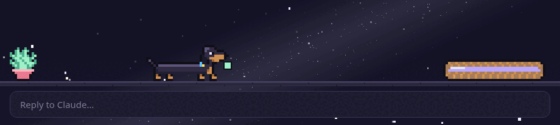
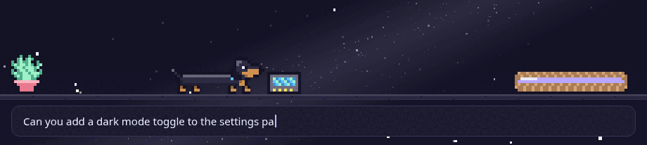
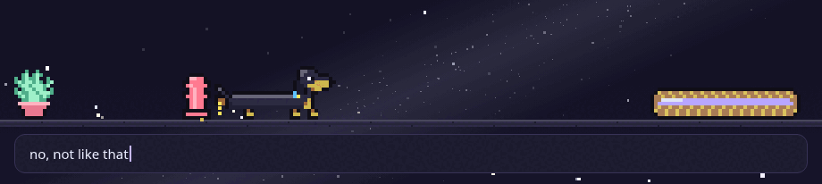
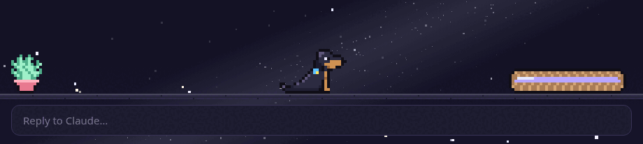
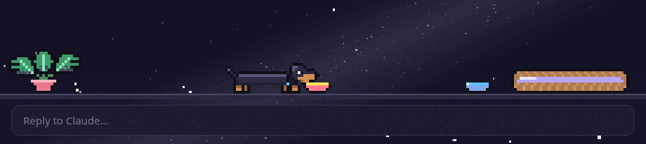
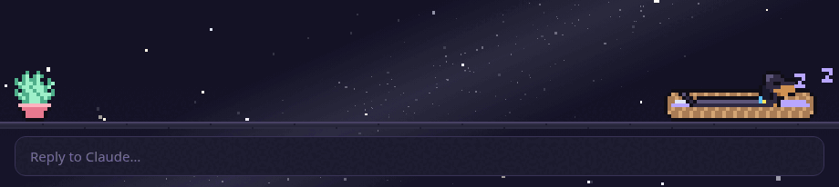
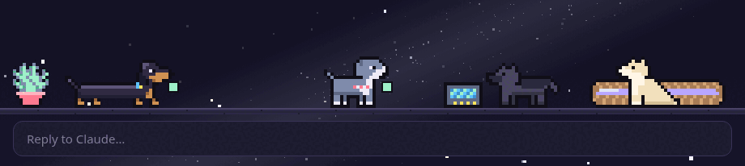
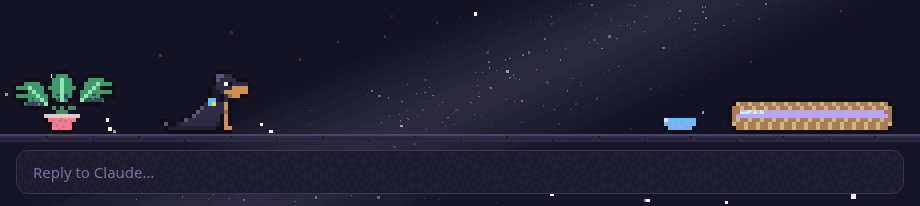
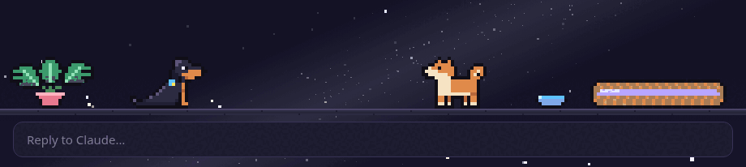

# claude-space-dog

A Claude Code mod for the desktop app: a dark theme with pastel accents, an animated starry sky behind the conversation, and a pixel-art dachshund living right above the prompt box.



## What the mod does

**The theme**
- Dark "indigo night" colors with pastel accents (lavender, mint, lemon, sky blue, coral).
- In the background, a starry night crossed by the Milky Way, with twinkling stars and shooting stars.

**The dachshund** lives in a band above the prompt box, with a floor, a plant and a dog basket, and reacts to what's going on. Every now and then it barks "Woof!".

| When… | the dachshund… |
|---|---|
| nothing is happening | strolls from one end of the band to the other |
| you're typing a message | looks at its console |
| your message starts with "no" | pees on a fire hydrant |
| Claude is thinking | plays ball, thrown at random across the whole width |
| Claude has answered | sits down and waits |
| you've been idle for a while | eats from its bowl |
| you've been idle for 5 minutes | goes to sleep in its basket |

### Nothing happening: a stroll


### You're typing: the console



### Your message starts with "no": the fire hydrant



### Claude is thinking: playing ball


### Claude has answered: sitting and waiting



### Idle for a while: eating



### Idle for 5 minutes: sleeping



## One dog per agent

Every agent you launch brings in a dog, which appears in a glow at a random spot: a pit bull, a German shepherd, a Jack Russell or a shiba, each in three coats, so 12 different dogs before the first repeat. The dog follows its agent's state (ball while it works, console during a long tool call, sitting while it waits, lying down when idle).



A new agent's dog appears in a glow:



When the agent is done, its dog gets sucked into a black hole:



## Installation

You need the Claude desktop app, with Claude Code 2.1.323 or later. The terminal shows neither the background, the band nor the colors.

In a terminal session, at the Claude Code prompt:

```
/plugin install space-dog --marketplace bt0r/claude-space-dog
```

Answer `y` to add the marketplace, then pick the "user" scope to get it in all your sessions.

From a shell:

```bash
claude plugin install space-dog --marketplace bt0r/claude-space-dog
```

In the desktop app, where `/plugin` doesn't work: click **+** next to the prompt box, then **Plugins**, **Add marketplace** with `bt0r/claude-space-dog`, then **Add plugin**.

Once installed, new sessions load the mod on startup. In a session that's already open, type `/reload-plugins`.

## Development

- `hooks/register.tsx`: the mod's entry point (theme, the dachshund's moods, agent dogs, background clock).
- `hooks/dog-svg.ts`: builds the band's animations as SVG.
- `hooks/sky.ts`: draws the background frame by frame.
- `hooks/sprites.ts`: the sprites, generated by `gen_band.py` (`python3 gen_band.py hooks/sprites.ts`).
- `hooks/dog.test.tsx`: the tests, run with `claude plugin test .`.
- `scripts/screenshots.mjs`: regenerates the GIFs in `docs/screenshots/` from the mod's own drawing code (`node scripts/screenshots.mjs`, needs Node 23.6+, Chromium and ImageMagick).

To try a change without reinstalling: `claude --plugin-dir .`, or `/reload-plugins` if the mod is installed from this folder.
